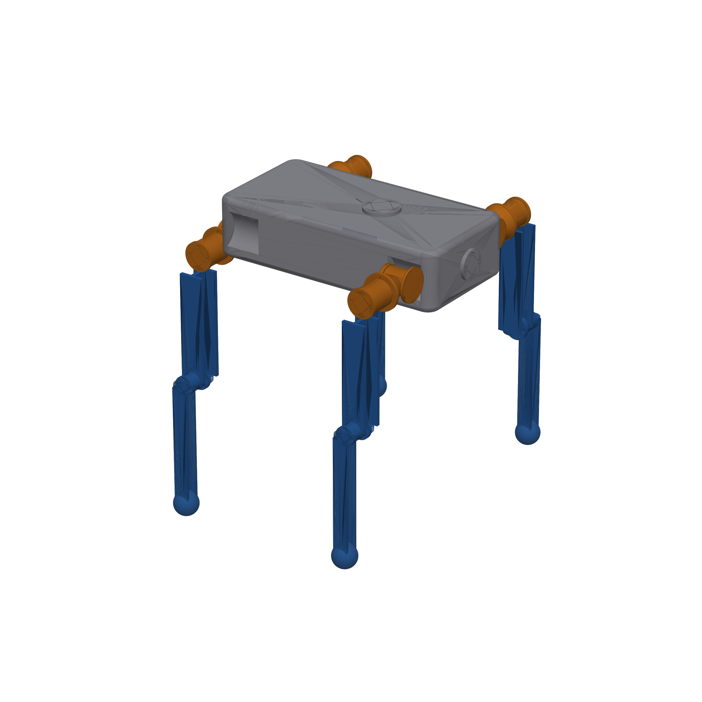

# Quadruped Locomotion Control

A quadruped robot designed from scratch, brought into the [Gazebo](https://gazebosim.org/) simulator with physically realistic mass, inertia and actuator limits, and driven by a set of Python gait controllers: crawl, wave, trot, an experimental bound, and live keyboard control.



## Highlights

- **Realistic robot model.** 12 actuated joints (ABAD / HIP / KNEE per leg). Mass and inertia are based on CubeMars AK80-9 actuators, and joint effort limits are capped at the AK80-9's 18 N·m peak torque.
- **3-DOF leg inverse kinematics.** Closed-form IK for each leg, with a matching forward-kinematics model checked by round-trip tests against the IK.
- **Leg odometry state estimation.** `leg_odometry.py` estimates body position and velocity from joint encoders, stance-leg kinematics and the IMU. It does not use Gazebo's ground-truth pose.
- **Several gaits.** Statically stable crawl and wave gaits with CoM shifting and ZMP / capture-point checks, plus a dynamic trot with reactive pitch/yaw correction and a safety abort.
- **Headless test harness.** Batch scripts launch gz-sim headless, reset the world, run a controller and shut down cleanly, so you can iterate quickly and unattended.

## Repository layout

```
.
├── src/                     Gait controllers and shared modules
│   ├── champgait.py         Walk/wave gait with CoM shifting and ZMP/capture-point checks
│   ├── champgait_wave.py    4-beat wave gait (always >= 3 feet planted)
│   ├── crawlgait.py         Crawl gait with per-leg CoM shifting
│   ├── trot_demo.py         Diagonal trot with reactive pitch/yaw correction
│   ├── gallop_demo.py       Experimental bound / half-bound gait
│   ├── manual_control.py    Drive the trot live from the keyboard (WASD)
│   ├── turn_test.py         Scripted forward / in-place turn / back / combined test sequence
│   ├── leg_odometry.py      Shared FK + IMU state estimator
│   ├── reset_sim.py         Resets the Gazebo world
│   └── legacy/              Older controller kept for reference
├── models/gencer_quadruped/ SDF model and STL meshes
├── worlds/world1.sdf        Simulation world
├── scripts/                 Windows launch helpers (headless run, loop, reset+run)
├── tools/                   Joint pub/sub wiring checks
├── docs/
│   ├── report/              Internship report (LaTeX + PDF)
│   ├── leg_odometry_fusion/ Write-up of the leg odometry / sensor fusion approach
│   ├── gait_debugging_report.md  Step-by-step account of the gait tuning process
│   ├── tuning_history/      Per-controller notes on how each constant was tuned
│   └── figures/             Renders, velocity plots and the render script
├── pixi.toml / pixi.lock    Reproducible environment (gz-sim 10, gz-transport 13)
```

## Requirements

- Windows 64-bit (the environment and launch scripts target `win-64`; `manual_control.py` reads the keyboard through the Win32 API)
- [pixi](https://pixi.sh/)

The environment variables in `pixi.toml` and the model URI in `worlds/world1.sdf` assume the repository is checked out at `C:\gz-ws`. If you clone it elsewhere, update `GZ_CONFIG_PATH` and `GZ_SIM_RESOURCE_PATH` in `pixi.toml` and the `<uri>` in `worlds/world1.sdf`.

## Getting started

```powershell
git clone https://github.com/gencere757/Quadruped-Locomotion-Control C:\gz-ws
cd C:\gz-ws
pixi install
```

### Run with the Gazebo GUI

```powershell
pixi run gz sim worlds\world1.sdf
```

Then, in a second terminal, reset the world and start a controller:

```powershell
scripts\run.bat trot_demo.py
```

### Run headless

```powershell
scripts\run_once.bat trot_demo.py      # one run, then gz-sim is shut down
scripts\run_loop.bat champgait_wave.py # keep gz-sim up and rerun the controller in a loop
```

Each controller writes its console output to a `run_log_*.txt` file in the working directory and moves the previous log into `run_log_archive/`. Both are git-ignored.

### Keyboard control

```powershell
scripts\run.bat manual_control.py
```

`W`/`S` drive forward and back, `A`/`D` turn, space stops, and `Q` or Esc quits.

## Documentation

- [Internship report](docs/report/report.pdf): robot design, export to Gazebo, IK derivation and leg odometry.
- [Leg odometry fusion](docs/leg_odometry_fusion/leg_odometry_fusion.pdf): how the state estimator combines kinematics and the IMU.
- [Gait debugging report](docs/gait_debugging_report.md): the core concepts, plus what each controller version changed and why.
- [Tuning history](docs/tuning_history/): the reasoning behind individual controller constants.

## Author

Arda Gencer
